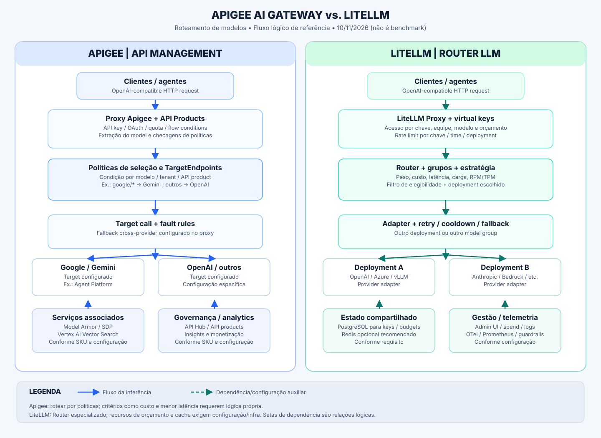

# Apigee AI Gateway vs. LiteLLM — comparação de roteamento de modelos

**Data da pesquisa:** 2026-11-10  
**Escopo:** despacho de solicitações para LLMs, critérios de seleção, balanceamento, resiliência, limites, custos e requisitos de operação.  
**Destino:** `rprojetos/roteadores-llm` · **Natureza:** estudo documental baseado em fontes primárias; **não é benchmark nem homologação de runtime**.  
**Desenho:** [Arquitetura comparativa](desenho-comparativo.svg)

> **Resumo decisório:** **LiteLLM** tem o conjunto mais explícito de algoritmos de seleção de **deployments de modelos** (pesos, custo, latência, ocupação, consumo RPM/TPM), fallbacks e SDK. **Apigee AI Gateway** aplica a governança de um **API management enterprise** a tráfego de IA, com roteamento declarativo por políticas e integração com segurança/analytics/catálogo/monetização. Um fluxo Apigee com roteamento, Model Armor, cache semântico e fallback é **montado/configurado**, não um motor equivalente ao Router do LiteLLM pronto para otimizar custo/latência automaticamente. [A1][A3][L2][L10]

## 1. Definição da comparação

- **Apigee AI Gateway** aqui é a **solução montada sobre Apigee X ou Apigee hybrid** (proxies, targets, policies, templates e serviços Google Cloud). **Não confundir** com o produto distinto **Google Cloud API Gateway**, que possui anúncio próprio de roteamento de modelos.
- **LiteLLM** aqui abrange **LiteLLM Proxy / AI Gateway** com seu **Router** e a biblioteca Python, separando recursos do núcleo, módulos configuráveis e **Auto Router (add-on)**.
- **Legenda:** ✅ documentado e disponível na plataforma quando configurado; ◐ viável por composição, configuração extra, serviço externo ou função complementar, sem paridade pronta comprovada; ❌ não é característica desse produto no recorte. **✅ não significa ativo por padrão, gratuito ou homologado aqui.**
- A expressão **“exclusivo”** indica **diferencial pronto/documentado comparativamente**, e não impossibilidade de reproduzir a funcionalidade com desenvolvimento adicional na alternativa.

## 2. Matriz de capacidades

| Capacidade de roteamento / operação | Apigee AI Gateway | LiteLLM | Leitura prática |
|---|---|---|---|
| Endpoint único OpenAI-compatible | ✅ no proxy do tutorial, mediante configuração [A1] | ✅ no gateway, interface uniforme [L1] | Comum; cobertura por endpoint deve ser testada |
| Seleção por nome/prefixo de modelo | ✅ condições de rota (ex.: `google/`) [A1] | ✅ modelo/grupo/alias no Router [L2] | Comum |
| Roteamento entre clouds/provedores | ✅ targets e políticas por provedor [A1][A2] | ✅ adaptadores para 100+ provedores [L1] | Comum; esforço de adaptação difere |
| Roteamento por políticas de negócio | ✅ flow conditions, produtos e atributos [A1][A3] | ✅ tags, regras por chave/equipe e plugins [L2][L3] | Comum, mecanismos diferentes |
| Múltiplos deployments por modelo | ◐ via targets/configuração de Apigee [A3] | ✅ `model_list` e model groups [L2] | LiteLLM mais pronto para LLM |
| Balanceamento ponderado | ◐ políticas/infra de load balancing; não um modelo de peso por LLM no exemplo [A1][A3] | ✅ `simple-shuffle` com `weight`/RPM/TPM [L2] | Diferencial operacional LiteLLM |
| Menor custo automaticamente | ◐ requer lógica/catálogo de preços próprios; não aparece como estratégia de roteador no tutorial [A1] | ✅ `cost-based-routing` [L2] | Não pressupõe qualidade equivalente |
| Menor latência automaticamente | ◐ requer medição e lógica customizada [A1][A4] | ✅ `latency-based-routing` [L2] | Dependente da telemetria real |
| Menor ocupação / uso de TPM | ◐ implementação própria [A1] | ✅ `least-busy` e `usage-based-routing-v2` [L2] | Estratégias explícitas LiteLLM |
| Roteamento por complexidade/semântica do prompt | ◐ lógica de políticas e/ou classificador externo [A1] | ◐ Auto Router como add-on; configurações e custos adicionais [L8] | Não presumir incluído no núcleo OSS |
| Estratégias distintas por grupo de modelos | ◐ fluxos/targets distintos no proxy [A1] | ✅ routing groups e estratégias por grupo [L2] | Mais direto no LiteLLM |
| Regras por tenant, equipe ou chave | ✅ apps/API products e flows [A3] | ✅ virtual keys, teams, router settings [L3][L4] | Comum |
| Retries dentro de um grupo | ◐ codificação de fault rules / callouts [A1] | ✅ nativo no Router, por erro [L5] | Comum como resultado, não como padrão |
| Fallback cross-provider | ✅ template do estágio 4; necessita configuração [A1] | ✅ `fallbacks` de grupo e default [L5] | Comum |
| Fallback específico por contexto/content policy | ◐ regras manuais [A1] | ✅ `context_window_fallbacks` e `content_policy_fallbacks` [L5] | LiteLLM documenta diferenciação explícita |
| Cooldown / exclusão de destino falho | ◐ circuit breaker/failover configurados, sem equivalência automática demonstrada [A2] | ✅ cooldown e contadores de falha [L2][L5] | Não confundir com mero fallback |
| Roteamento sob limites RPM/TPM | ✅ políticas quota/token, com limitações de SKU [A5] | ✅ limites e estratégia usage-aware [L2][L4] | Comum; escalas de aplicação variam |
| Orçamento financeiro por chave/equipe | ◐ monetização/soluções de orçamento requerem desenho e serviços [A3][A8] | ✅ budgets por chave/equipe com PostgreSQL [L4] | LiteLLM possui fluxo específico de spend |
| Restrições de modelos por consumidor | ✅ API products e políticas [A3] | ✅ allowlists de modelos por virtual key [L3][L4] | Comum |
| Cache exato de respostas | ✅ cache de API geral, conforme política [A3] | ✅ cache local/Redis/S3/GCS [L6] | Comum |
| Cache semântico | ✅ políticas + Vertex AI Vector Search; Comprehensive [A1][A6] | ✅ Redis/Valkey/Qdrant semânticos quando configurados [L6] | Comum com infraestrutura adicional |
| Segurança de prompt e PII | ✅ Model Armor e Sensitive Data Protection integráveis [A1][A2] | ✅ guardrails/integrações configuráveis [L7] | Comum; fornecedores/controles diferem |
| Analytics de tokens/latência/erros | ✅ API Insights / analytics Apigee [A4] | ✅ spend/logs/OTel/Prometheus [L1][L4] | Comum |
| Chaves e autenticação de API | ✅ API keys, OAuth2, IAM e API products [A3] | ✅ virtual keys; integração de auth por configuração [L3] | Ênfase API corporativa em Apigee |
| Portal, catálogo e API products | ✅ recursos de API management/Hub [A3] | ◐ UI de administração do gateway, não equivalente a portal amplo [L1] | Diferencial Apigee |
| Monetização de APIs gerenciadas | ✅ add-on/capacidade comercial conforme SKU [A7] | ◐ spend/budgets; cobrança externa não equivalente [L4] | Não comparar spend com faturamento |
| Self-host independente de cloud | ❌ Apigee não é software OSS para self-host irrestrito; hybrid é runtime gerenciado [A2] | ✅ Proxy self-hosted [L1] | Diferencial LiteLLM |
| Implantação híbrida gerenciada Google | ✅ Apigee hybrid para Kubernetes [A2] | ◐ containers/Kubernetes autogeridos [L1] | Modelos de responsabilidade distintos |
| SDK Python embutível de roteamento | ❌ não é o modelo do Apigee [A3] | ✅ `litellm.Router` no SDK [L2] | Diferencial LiteLLM |
| Licença de software base | Comercial Google Cloud, sujeito a preços/SKU [A7] | OSS principal MIT; diretório Enterprise tem licença própria [L9] | Custos de infra/provedores continuam |
| Dependências mínimas do cenário comparado | Apigee org/proxy/targets; Model Armor/Vector Search e Comprehensive para caso completo [A1][A7] | Servidor LiteLLM; PostgreSQL para keys/budgets, Redis recomendado em multiworker [L3][L4][L6] | Não vender soluções como 'zero configuração' |
| MCP e agentes (fora do escopo central) | ✅ integração e governança de tools/MCP [A3] | ✅ MCP gateway/A2A [L1] | Ambos, mas estudo restringe inferência LLM |

**Observações para interpretar a matriz:** 

1. No exemplo oficial Apigee, o campo `model` de uma requisição OpenAI-compatible direciona `google/*` para o target Gemini e os demais modelos para OpenAI; o fallback acrescentado é uma `DefaultFaultRule` com `ServiceCallout` disparada por status 4xx/5xx. Isso **não demonstra** que Apigee escolhe de fábrica o provedor mais barato ou mais rápido. [A1]
2. A capacidade declarativa de Apigee pode implementar roteamento corporativo sofisticado, mas há diferença entre **poder programar** a política e **ter algoritmo de seleção embutido**, com memória de latência/uso, cooldown e fallback por classe de erro. [A1][L2][L5]
3. No LiteLLM, `simple-shuffle` é a seleção padrão; `cost-based-routing`, `latency-based-routing`, `least-busy` e `usage-based-routing-v2` são estratégias expressas na documentação. Um grupo pode ter estratégia própria e pesos definidos por chave/equipe. [L2]
4. **Cache semântico** é diferente de **roteamento semântico**: cache tenta reutilizar resposta de prompt similar; roteamento semântico/classificador escolhe modelo. Ambos podem exigir componentes adicionais e qualquer cache semântico exige cautela em conversas e agentes com contexto. [A6][L6][L8]
5. **Disponibilidade varia por SKU e infraestrutura:** tutorial Apigee exige ambiente **Comprehensive** para Model Armor e políticas de cache semântico; a página das políticas `PromptTokenLimit`/`LLMTokenQuota` declara expressamente que **não se aplica ao Apigee hybrid**. No LiteLLM, budgets e virtual keys exigem **PostgreSQL**, e funcionalidades marcadas Enterprise têm licença específica. [A1][A5][A7][L3][L4]

## 3. Em comum — o que efetivamente resolve o mesmo problema

| Necessidade | Implementação em Apigee | Implementação em LiteLLM |
|---|---|---|
| Cliente usa endpoint estável | API proxy com rota OpenAI-compatible | Proxy OpenAI-compatible, `model_name`/aliases |
| Encaminhar por modelo | Condição sobre `llm.model` + target | Resolução de model group + deployment |
| Tratar indisponibilidade | Target fault rules, callouts e padrões de circuito | Retries, cooldown e fallbacks do Router |
| Limitar uso | Policies de API/LLM token e API products | Limites por chave, user, team e deployment |
| Proteger tráfego | Políticas Apigee + Model Armor/SDP | Guardrails e integrações |
| Ver gasto e uso | Analytics/insights, proxies e produtos | Tokens, preços, spend, logs por chave/equipe |
| Reutilizar respostas | Cache e cache semântico com dependências | Cache exato ou semântico configurado |

**Conclusão da zona comum:** ambos podem ser **ponto central de acesso a LLMs**, com roteamento multi-provedor, regras de consumo, resiliência e observabilidade. A **forma de implantação** e o **grau de especialização do seletor** são muito diferentes. [A1][A3][L1][L10]

## 4. Capacidades de destaque de cada solução

### 4.1 Mais prontas ou mais profundas no LiteLLM

- **Roteamento algorítmico especializado:** `simple-shuffle`, `least-busy`, `usage-based-routing-v2`, `latency-based-routing` e `cost-based-routing`, escolhendo entre **deployments elegíveis**, não apenas entre URLs fixas. [L2]
- **Modelo operacional robusto do Router:** retries dentro do mesmo grupo, fallback para outro grupo, cooldown por deployment, filas de prioridade e fallback especial por janela de contexto ou política de conteúdo. [L5]
- **Ajuste de estratégia por grupo e tenant:** pesos e ajustes por chave/equipe e routing groups sem necessidade de construir um proxy API diferente para cada combinação. [L2]
- **SDK Python:** usar `litellm.Router` dentro da aplicação, além de operar como serviço proxy; viabiliza experimentos locais reproduzíveis. [L2][L11]
- **Catálogo amplo de adaptadores** (o projeto declara mais de 100 provedores), com tradução de formatos e parâmetros. Cobertura de endpoints e recursos específicos deve ser validada modelo a modelo. [L1][L10]
- **Auto Router** pode escolher modelo por prompt/complexidade; a página o identifica como **add-on**. Não presumir gratuidade, inclusão na instalação básica ou substituição dos algoritmos convencionais. [L8]

### 4.2 Mais prontas ou mais profundas no Apigee

- **Gestão corporativa de APIs**: API products, apps, OAuth2, IAM, quotas, integração com API Hub e controles de ciclo de vida; não apenas despacho de inferência. [A3]
- **Políticas declarativas de mediação e governança**: condições de fluxos, enriquecimento e transformação de mensagens, alvos internos/externos e composição por feature templates. [A1][A9]
- **Integração Google Cloud**: Model Armor, Sensitive Data Protection, Agent Platform / Vertex AI Vector Search e observabilidade integrada, dependendo do produto/ambiente contratado. [A1][A2][A4]
- **Governança de APIs para agentes e ferramentas**, com exposição de serviços como MCP e descoberta no API Hub. Tem valor quando a organização também governa API REST, ferramentas e agentes. [A3]
- **Implantação Apigee X/hybrid** e capacidade de gestão centralizada empresarial, sujeitas às regras de licenciamento e topologia do serviço. **Hybrid não significa versão open source autogerenciável**. [A2][A7]

## 5. Dois fluxos de roteamento em profundidade

### Fluxo A — Apigee AI Gateway

1. A aplicação envia uma chamada HTTP no contrato do proxy (no tutorial, `/v1/chat/completions`).
2. Apigee autentica o consumidor, avalia políticas, quotas, requisitos de segurança e extrai os atributos da requisição.
3. **Flow condition** decide qual `TargetEndpoint` usar (exemplo documentado: `model` com prefixo `google/`).
4. Opcionalmente, políticas de **Model Armor** verificam tráfego e o **SemanticCacheLookup** tenta responder sem chamar o LLM; há dependências e SKU específicos.
5. O target chama o provedor. No template de fallback, um status 4xx/5xx ativa tratamento de falha e `ServiceCallout` para o outro provedor.
6. Resposta retorna ao cliente; analytics registram a experiência. Para estratégias do tipo *menos custoso*, *menos ocupado* ou *menor P95*, é necessário definir e testar algoritmo e fontes de telemetria próprios. [A1][A4]

**Ponto crítico:** um fallback indiscriminado para qualquer 4xx, como no tutorial, pode reenviar pedidos inválidos, não autorizados ou rejeitados por política; em produção, classificar 401/403/404/429, idempotência e efeitos de repetição antes de habilitar. [A1]

### Fluxo B — LiteLLM

1. Aplicação envia `model=<grupo>` ao Proxy (ou chama o `Router` Python).
2. Proxy verifica virtual key, lista de modelos permitidos e orçamento/limite, quando devidamente configurados.
3. O Router resolve grupo/alias, filtra deployments inelegíveis (por regras de acesso, cooldown, limites e atributos relevantes).
4. Uma estratégia escolhe entre deployments candidatos: peso, menor custo, menor latência, menor ocupação ou menor consumo.
5. O adaptador de provedor envia a requisição ao backend. Se há erro recuperável, o Router pode tentar outro deployment do grupo; depois, outro grupo via `fallbacks`; falhas recorrentes entram em cooldown.
6. A resposta é normalizada para o cliente e os custos/contadores podem ser atualizados. [L2][L5][L10]

**Ponto crítico:** selecionar o deployment de menor preço **não prova** menor custo por tarefa útil; qualidade, taxa de tentativas, contexto, cache, tokens de saída e SLAs devem ser medidos. Fallback após emissão parcial de stream e modelos com formatos incompatíveis merecem testes próprios. [L5]

## 6. Arquitetura comparativa

[Ver SVG separadamente](desenho-comparativo.svg).

O desenho distingue **fluxo da chamada** (setas sólidas), **dependências de controle/dados** (tracejadas) e **pontos de configuração que não são padrão universal**. Os provedores à direita de cada gateway são **exemplos de targets**, não uma lista exaustiva.

## 7. Qual escolher — conforme a decisão real

| Cenário | Escolha favorecida | Motivo |
|---|---|---|
| Criar um gateway LLM experimental, barato em esforço de engenharia, com políticas de seleção testáveis | **LiteLLM** | Router, SDK e configuração de deployments prontos |
| Balancear múltiplas regiões e provedores por latência/custo/RPM/TPM | **LiteLLM** | Estratégias e fallbacks especializados declarados |
| Governo corporativo de APIs, apps, produtos, portais, políticas, compliance e integração Google Cloud | **Apigee** | API management amplo e serviços associados |
| Empresa já opera Apigee como gateway institucional | **Apigee** (ou Apigee + LiteLLM) | Evita duplicar a camada de autenticação/governança |
| Precisar políticas de API enterprise na borda **e** roteador dinâmico de modelos internamente | **Composição Apigee → LiteLLM** | Apigee: acesso e políticas; LiteLLM: seleção e failover entre LLMs |

**Possibilidade de arquitetura composta (não recomendação automática):** colocar Apigee na borda e LiteLLM atrás pode combinar governança e seleção especializada, **mas acrescenta dois saltos, dois mecanismos de retry/timeout, dois rate limiters e potencialmente dupla contagem de custo**. Definir inequivocamente qual camada é dona de auth, quotas, fallback, timeout, cache e observabilidade. Validar com PoC antes de produção.

## 8. Prova de conceito mínima e critérios de aceite

Para comparação objetiva, implementar **o mesmo contrato de chamadas e o mesmo conjunto de modelos** em ambos, com os mesmos limites e métricas de custo. Não comparar capacidades habilitadas em um sistema com recursos desabilitados no outro.

| Caso | Cenário controlado | Critério observável |
|---|---|---|
| P01 | Modelo A e B em provedores distintos | Rota efetiva correta com log de modelo/target |
| P02 | 80/20 entre dois deployments | Distribuição amostral e variação mensuradas |
| P03 | A falha com 429/503; B saudável | Fallback com erro/retry classificado, sem loops |
| P04 | A envia 401/403 ou prompt viola política | Não contornar autorização/guardrail via fallback |
| P05 | Dois modelos com custos e latências diferentes | Custo total **por resposta válida**, P50/P95 e TTFT |
| P06 | Limite de uso e orçamento atingidos | Bloqueio, erro ou failover conforme política explícita |
| P07 | Requisições streaming; queda após primeiro token | Sem duplicação invisível ou stream corrompido |
| P08 | Chamadas multi-turn similares | Cache exato/semântico não mistura contexto/tenants |
| P09 | 2+ instâncias do gateway | Estados de limite/cooldown consistentes onde exigido |
| P10 | Tenant sem acesso ao modelo fallback | Fallback não viola allowlist |

Métricas mínimas: **custo efetivo por resposta aceitável, TTFT, latência P50/P95/P99, taxa de erros, número de tentativas upstream, tokens entrada/saída, cache hit e razão de fallback**. Registrar configurações, versões e custos de infraestrutura; não inventar benchmarks sem execução.

## 9. Limitações e conclusão

- **Não foi feito deploy, benchmark nem teste de API real**: a revisão é documental. As capacidades variam por versão, SKU, extensão, provedor e implantação; valide um snapshot antes de decisões comerciais.
- **Não há exclusividade absoluta** de engenharia: Apigee pode receber algoritmos customizados; LiteLLM pode ganhar políticas corporativas por infraestrutura e integrações. O relatório compara capacidades **evidenciadas sem implementação própria adicional**.
- **Modelo de licenças:** LiteLLM usa MIT fora das áreas licenciadas separadamente como Enterprise; Apigee depende de contratos/planos Google Cloud. Serviços de modelos, hospedagem e segurança geram custos independentes. [L9][A7]
- **Conclusão final:** para um projeto cujo foco explícito é **rotear modelos LLM por regras técnicas, custo, latência, capacidade e disponibilidade**, a **referência inicial mais aderente é LiteLLM**. Para um projeto focado em **governança empresarial de APIs e tráfego de IA**, **Apigee** possui proposta mais ampla. Avaliar a arquitetura composta somente se ambos os grupos de requisitos forem obrigatórios.

## Fontes primárias auditáveis

As fontes foram lidas durante a pesquisa em **10/11/2026**. Links apontam para documentação de produto e repositórios oficiais/amostras; artigos exemplificativos são tratados como **exemplos**, não promessas de comportamento padrão.

- **[A1]** [Apigee — Build an AI gateway with routing, Model Armor, and semantic cache](https://docs.cloud.google.com/apigee/docs/api-platform/fundamentals/build-ai-gateway)
- **[A2]** [Google Cloud — Apigee AI solutions / visão geral e capacidades](https://cloud.google.com/solutions/apigee-ai)
- **[A3]** [Apigee — AI gateway capabilities](https://docs.cloud.google.com/apigee/docs/api-platform/get-started/ai-capabilities)
- **[A4]** [Apigee — API Insights dashboards](https://docs.cloud.google.com/apigee/docs/apihub/api-insights-dashboard)
- **[A5]** [Apigee — LLM token policies (página não aplicável a Apigee hybrid)](https://docs.cloud.google.com/apigee/docs/api-platform/tutorials/using-ai-token-policies)
- **[A6]** [Apigee — Semantic caching policies](https://docs.cloud.google.com/apigee/docs/api-platform/tutorials/using-semantic-caching-policies)
- **[A7]** [Apigee — Tipos de ambientes pay-as-you-go](https://docs.cloud.google.com/apigee/docs/api-platform/reference/pay-as-you-go-environment-types)
- **[A8]** [gcp-samples — AI Gateway Labs (exemplos, não produto pronto)](https://github.com/gcp-samples/ai-gateway-labs)
- **[A9]** [gcp-samples — Templates Apigee (repositório em beta)](https://github.com/gcp-samples/apigee-template-repository)
- **[L1]** [LiteLLM — AI Gateway](https://docs.litellm.ai/docs/simple_proxy)
- **[L2]** [LiteLLM — Router strategies / model groups](https://docs.litellm.ai/docs/router/learn/strategies)
- **[L3]** [LiteLLM — Virtual keys](https://docs.litellm.ai/docs/proxy/virtual_keys)
- **[L4]** [LiteLLM — Budgets and rate limits](https://docs.litellm.ai/docs/proxy/users)
- **[L5]** [LiteLLM — Retries, fallbacks and cooldowns](https://docs.litellm.ai/docs/router/learn/reliability)
- **[L6]** [LiteLLM — Caching](https://docs.litellm.ai/docs/proxy/caching)
- **[L7]** [LiteLLM — Guardrails](https://docs.litellm.ai/docs/proxy/guardrails/quick_start)
- **[L8]** [LiteLLM — Auto Router (Add-on)](https://docs.litellm.ai/docs/auto_router/)
- **[L9]** [BerriAI/litellm — LICENSE oficial](https://github.com/BerriAI/litellm/blob/main/LICENSE)
- **[L10]** [LiteLLM — Life of a Request](https://docs.litellm.ai/docs/proxy/architecture)
- **[L11]** [BerriAI/litellm — código-fonte e README](https://github.com/BerriAI/litellm)
